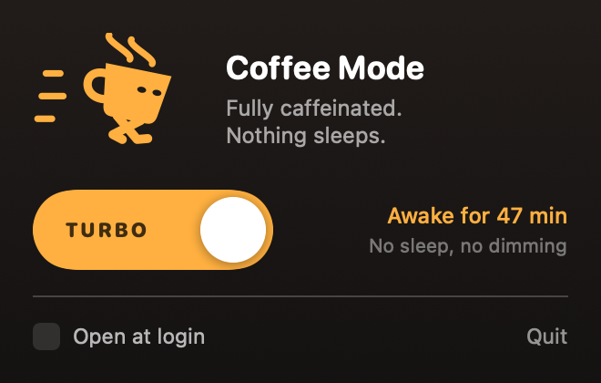
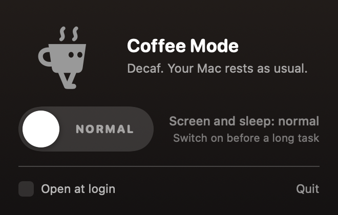

# Coffee Mode

**One switch that keeps your Mac awake.** A coffee cup in the menu bar: flip it to Turbo and nothing sleeps, dims or starts a screensaver. Flip it back and the Mac behaves as if nothing happened.

<p>
  
  
</p>

## Why I built it

I hand long research runs to AI agents: hours of reading through thousands of web pages. Whenever my Mac went to sleep, the run died with it, and I only found out when I came back to half a result.

The usual fix is to switch sleep off in System Settings, forget to switch it back, and drain the battery for a week. I wanted a fix that is impossible to forget to undo.

## What makes it different

- **It changes no system settings.** It only holds a "stay awake" request while it is on. Quit it, or let it crash, and everything is back to normal by itself.
- **Scripts can flip the switch**, so a long job can turn it on by itself and off again when it finishes:

  ```bash
  kill -USR1 $(pgrep -x CoffeeMode)
  ```

- **It shows how long the Mac has been held awake**, so it never stays on by accident.
- The cup in the menu bar breaks into a run while it is on.

## How it works

1. **Flip.** A small menu bar panel with one toggle. Nothing to configure.
2. **Ask.** The app asks macOS to hold off sleep and display dimming (power assertions, the same mechanism a video player uses).
3. **Hold.** Every 30 seconds it tells the Mac someone is active, so the screensaver stays away.
4. **Release.** Off, quit or crash: the requests disappear with the app.

To check that it is holding the Mac awake:

```bash
pmset -g assertions | grep "Coffee Mode"
```

One limit: closing the lid on battery power still puts the Mac to sleep.

## Build it

Needs macOS 13 or later and the Xcode command line tools (no Xcode project).

```bash
./build.sh
```

This compiles `src/main.swift`, builds `Coffee Mode.app` and installs it in `/Applications`.

## How it was made

I am not a programmer. I decided what the app should do and how it should feel, and tested it on my own long runs. An AI coding assistant (Claude Code) wrote the Swift.
